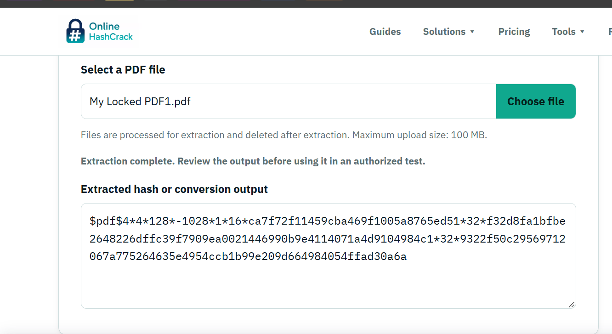
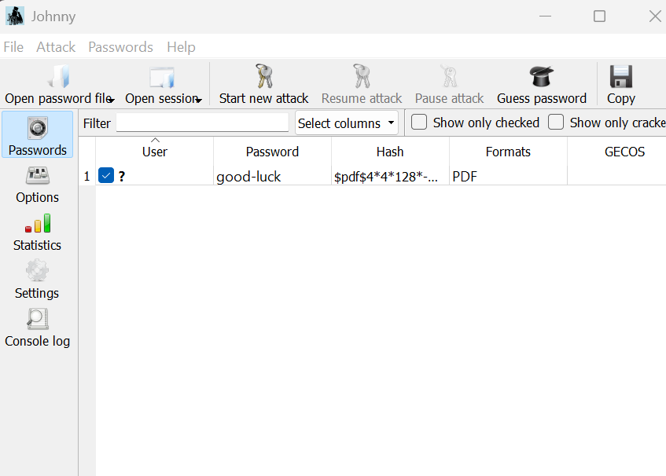
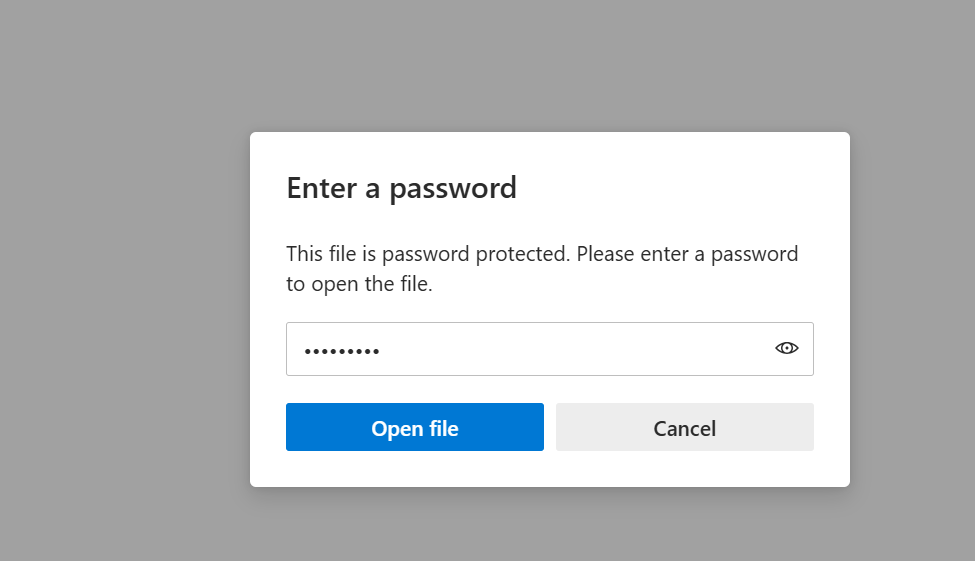
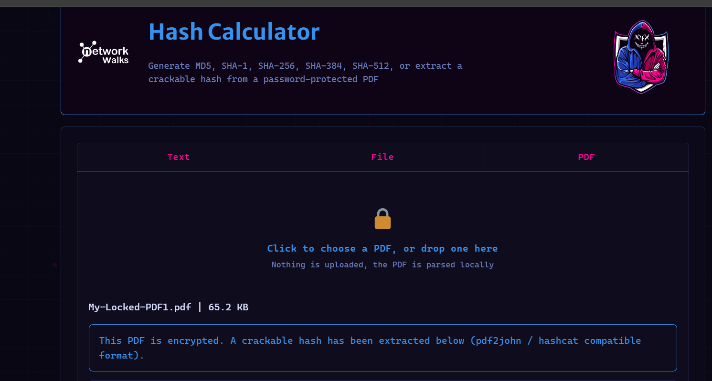
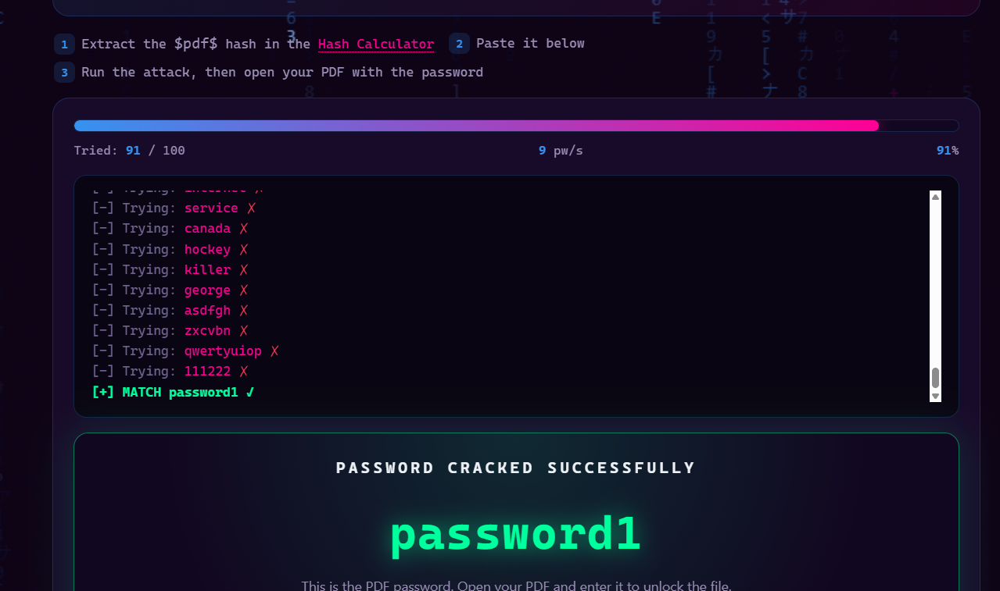

# 🔐 Password Cracking

**Exploring password-cracking techniques using John the Ripper (JTR) and Networkwalks security tools, focusing on password hash identification and recovery.**

  
  
  
  

---

## 📌 Project Overview

This project demonstrates the process of recovering a password from a password-protected file using industry-standard tools.

Security professionals use password recovery techniques to test password strength and to highlight the risks of weak passwords. If a password is short or predictable, it can be found quickly — proving the need for strong password practices.

The lab used four freely available tools: **John the Ripper (JTR), Johnny (JTR's graphical interface)**, and two tools developed by Networkwalks — **Hash Calculator** and **Password Cracker** — to demonstrate the recovery of a password-protected PDF file.

---

## 🎯 Objectives

- Understand the fundamentals of password cracking and password recovery techniques.
- Gain practical experience using John the Ripper (JTR) and Johnny for password-cracking operations.
- Understand how the Networkwalks Hash Calculator generates and identifies password hashes.
- Explore the Networkwalks Password Cracker tool for recovering passwords.
- Demonstrate how security tools can recover the password of a protected PDF file in a controlled lab environment.
- Understand the importance of strong passwords and effective security practices in preventing unauthorised access.

---

## 🏗️ Tools and Technologies Used

| ⚙️ Tool                          | 🧩 Purpose                                |
| --------------------------------- | ----------------------------------------  |
| John the Ripper (JTR)             | Password hash analysis and recovery       |
| Johnny                            | Graphical interface for John the Ripper   |
| Networkwalks Hash Calculator      | Hash extraction from PDF files            |
| Networkwalks Password Cracker     | Password recovery via dictionary attack   |
| OnlineHashCrack                   | Online PDF hash extraction                |

---

## 🪜 Lab Environment

- **Target File:** Password-protected PDF (`My-Locked-PDF1.pdf`)
- **Tools:** JTR, Johnny, Networkwalks Hash Calculator, Networkwalks Password Cracker, OnlineHashCrack
- **Environment:** Controlled laboratory environment

---

# Practical Implementation

## Step 1 — OnlineHashCrack: Extract the PDF Hash

OnlineHashCrack is an online tool that can extract a crackable hash from a password-protected PDF file.

**Activities:**
- Uploaded the password-protected PDF (`My Locked PDF1.pdf`) to OnlineHashCrack.
- Extracted the PDF password hash in `$pdf$` format.
- Saved the hash value as `hash1.txt` for use with John the Ripper.

---

## Step 2 — John the Ripper (JTR) and Johnny

Johnny is the graphical user interface for John the Ripper, simplifying password-cracking operations.

**Activities:**
- Launched Johnny (JTR GUI).
- Imported `hash1.txt` into John the Ripper.
- Configured and executed the password recovery process.
- Password was successfully cracked: **`good-luck`**
- Verified the recovered password by opening the protected PDF.

---

## Step 3 — Networkwalks Hash Calculator

The Networkwalks Hash Calculator extracts a crackable hash directly from a password-protected PDF file (locally, without uploading).

**Activities:**
- Accessed the Networkwalks Hash Calculator and selected the **PDF** tab.
- Uploaded `My-Locked-PDF1.pdf` for local parsing.
- The tool extracted a `pdf2john` / hashcat-compatible hash.
- Copied the hash output for use in the Password Cracker.

---

## Step 4 — Networkwalks Password Cracker

The Networkwalks Password Cracker performs a dictionary-based attack using the extracted hash.

**Activities:**
- Pasted the hash from the Hash Calculator into the Password Cracker.
- Ran the attack — the tool tried common passwords one by one.
- Password successfully recovered: **`password1`**
- Verified the recovered password by opening the PDF.

---

## Results and Findings

The lab provided practical exposure to password recovery using multiple security tools. It demonstrated how password-protected PDF documents can be assessed using different approaches.

**Key findings:**
- Password hashes can be extracted and analysed using specialised security tools.
- Both JTR/Johnny and the Networkwalks Password Cracker successfully recovered passwords using dictionary-based attacks.
- Weak, common passwords (e.g. `password1`, `good-luck`) are highly susceptible to dictionary attacks.
- Strong password practices significantly reduce the risk of unauthorised access.

---

# 💡 What I Learned

**Key takeaways:**
- How password hashes work and their role in securing documents.
- How to extract PDF hashes using OnlineHashCrack and the Networkwalks Hash Calculator.
- How to use John the Ripper (JTR) and Johnny for password recovery.
- How dictionary-based attacks work and why weak passwords are vulnerable.
- The importance of strong passwords, secure encryption, and proper password management.

---

# 🔐 Security Recommendations

- Use long and complex passwords (12+ characters with mixed case, numbers, and symbols).
- Avoid predictable or commonly used passwords.
- Use secure password hashing algorithms for sensitive data.
- Apply strong encryption to sensitive documents.
- Use a password manager to generate and securely store passwords.

---

# Conclusion

This practical exercise strengthened my understanding of password security, hash analysis, and password recovery techniques. Working with John the Ripper, Johnny, and the Networkwalks tools provided hands-on experience with security assessment tools and highlighted the critical importance of strong authentication practices.

---

# 👤 Author

**Nweke Chidimma**\
Cybersecurity Intern · Batch B084

---

## 📌 Project Information

**Program:** Networkwalks Cybersecurity Internship | **Week:** 03 | **Project:** Password Cracking (PM2 & PM3) | **Repository:** GitHub
